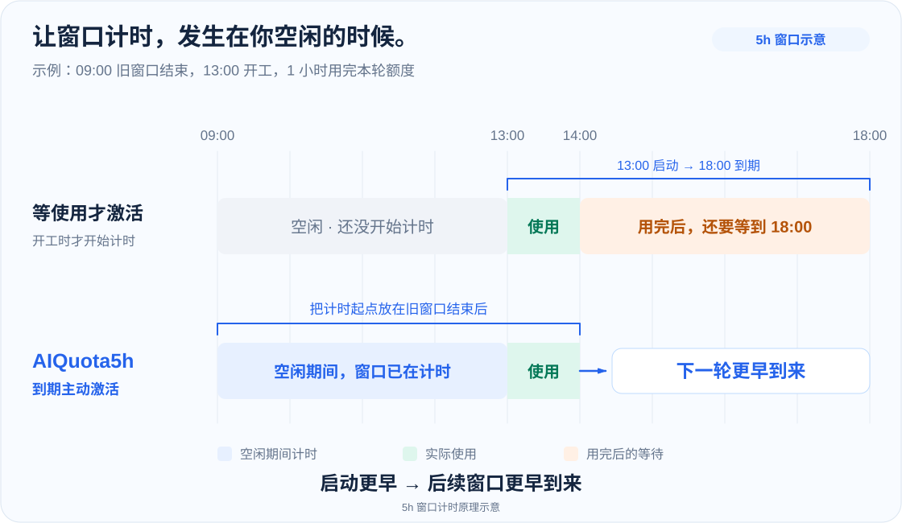
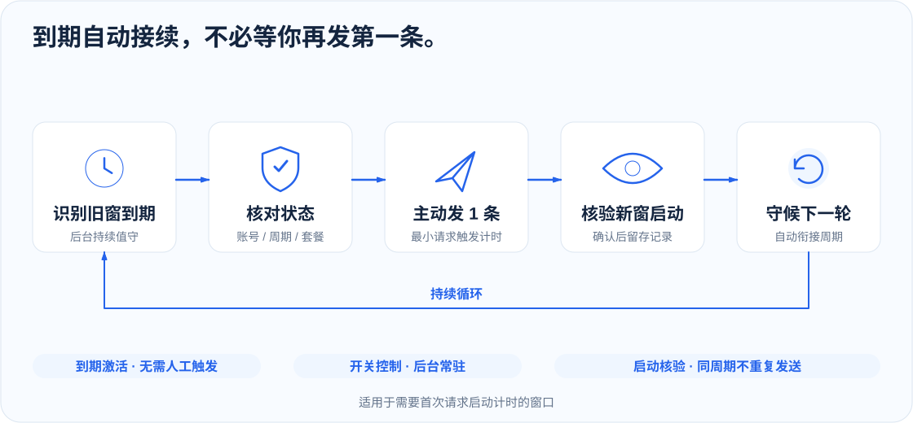
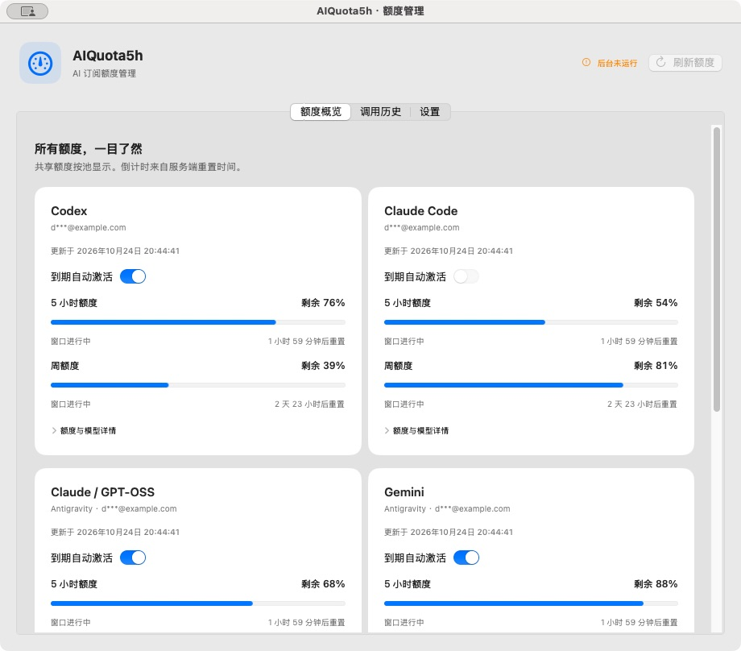

<p align="center">
  
</p>

<h1 align="center">AIQuota5h</h1>

<p align="center">
  <strong>到期自动激活，让下一轮计时不等你开工。</strong><br>
  5 小时 / 周额度窗口 · 后台自动接续
</p>

<p align="center">
  <a href="#自动接续流程">工作原理</a> ·
  <a href="#安装使用">安装使用</a> ·
  <a href="#使用文档">使用文档</a>
</p>

<p align="center">
  
</p>

## 自动接续流程



## 激活开关与执行记录



*界面使用演示数据。*

## 安装使用

macOS 15+ · Node.js 24+ · Xcode Command Line Tools

```bash
git clone https://github.com/ming2363/AIQuota5h.git
cd AIQuota5h
npm ci
npm run install:macos
```

打开 `~/Applications/AIQuota5h.app`，按额度池开启「到期自动激活」。后台会持续运行，关闭管理窗口后仍继续处理。

## 使用文档

[安装与操作](docs/USAGE.md) · [平台接入](docs/ADAPTERS.md)

## 开发与验证

```bash
npm test
npm run build:macos
```

`src/` 后台与激活决策 · `macOS/` 原生管理界面 · `test/` 自动验证
