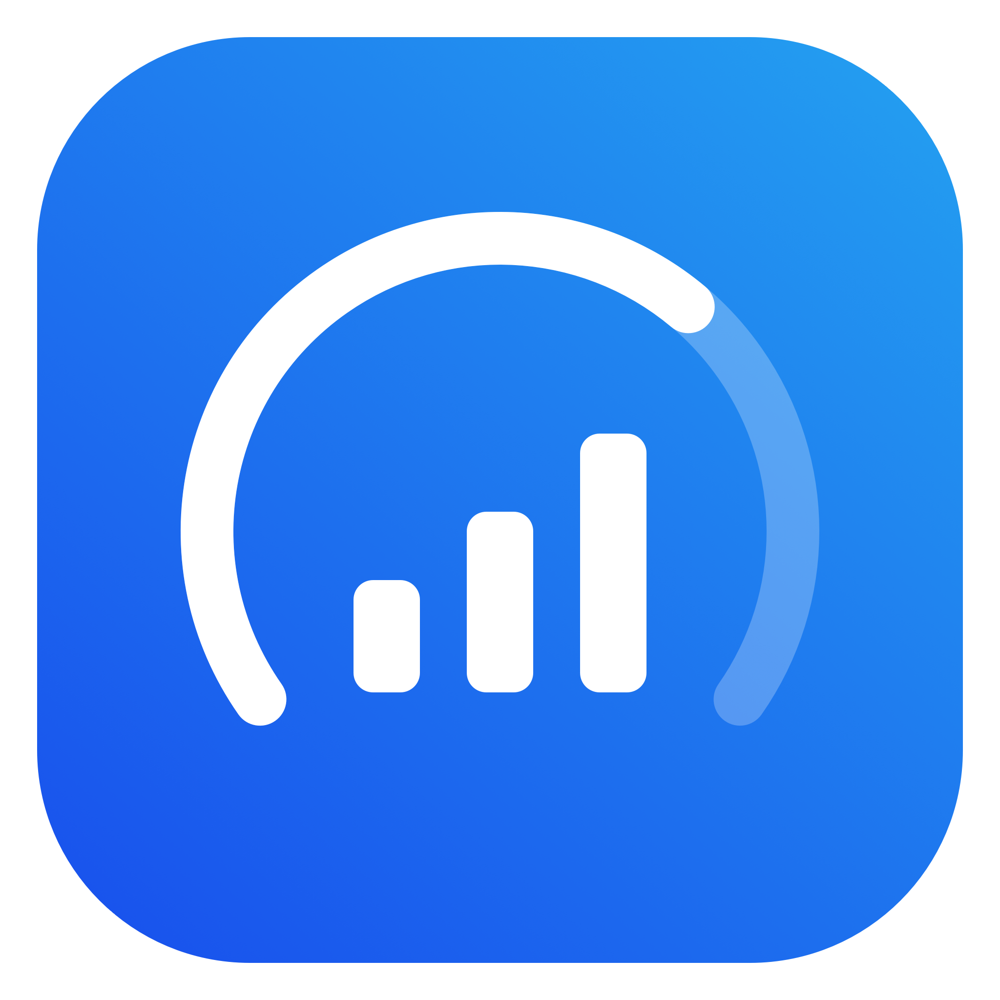
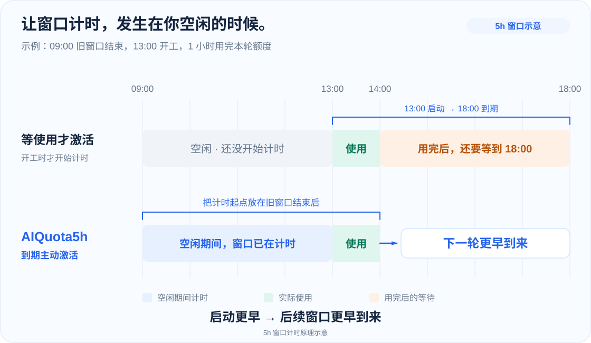
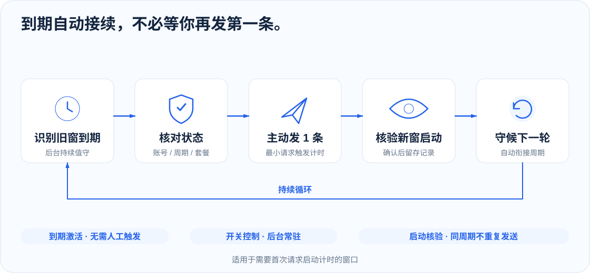
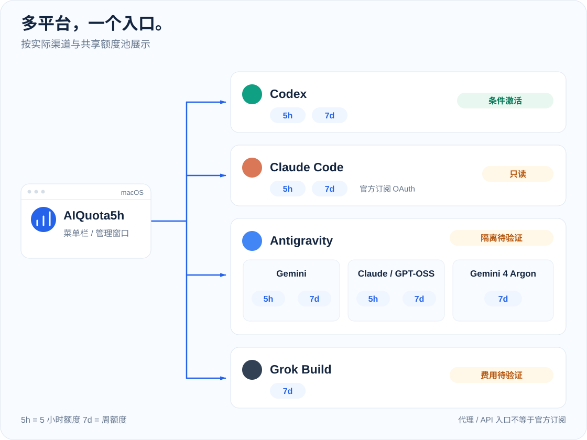

<p align="center">
  
</p>

<h1 align="center">AIQuota5h</h1>

<p align="center">
  <strong>Start the next quota window the moment the old one ends — not when you next sit down to work.</strong><br>
  A macOS menu-bar app and background service for 5-hour / weekly AI subscription windows.
</p>

<p align="center">
  English · <a href="README.zh-CN.md">简体中文</a> · <a href="CHANGELOG.md">Changelog</a>
</p>

<p align="center">
  
</p>

## Why

Subscription coding tools such as Claude Code and Codex meter usage in rolling windows (typically 5 hours, plus a weekly cap). A new window only starts when you send the first request after the previous one has ended. If the old window expires at 3 a.m. and you start work at 9 a.m., the next window runs 9 a.m.–2 p.m., and every later window shifts with it.

AIQuota5h watches those windows. About 65 seconds after a window ends, it re-checks the account, remaining quota and billing safety, sends one minimal request through the official client, and then confirms from the provider's own quota data that the new window has really started. Idle time is no longer wasted.

## Features

- **Automatic window activation** — per quota pool, with a 65-second grace period after the old window ends.
- **Verified, never guessed** — a window is only activated when the provider's data proves the old period has ended; the new window is confirmed from fresh quota readings afterwards.
- **Billing guardrails** — sending is allowed only when the account is on a plan where the request is covered by the subscription (for example, extra usage / overage explicitly off). Unknown billing state means monitor only.
- **No duplicate sends** — each window period gets at most one activation task. Timeouts, restarts, stale snapshots and window-ID changes never cause the same request to be sent again.
- **Native macOS dashboard** — quota overview, per-pool activation switches, per-provider monitoring switches, and a history of quota reads and activation tasks.
- **Runs in the background** — a LaunchAgent keeps the service alive after you close the window; "Quit completely" stops it until you open the app again.
- **Account changes handled** — when you sign in with a different account, tasks and snapshots of the old account are dropped automatically.
- **Local only** — reuses the existing login of each official client; no keys in the UI, no network listener, accounts masked in the UI.



## Supported providers

| Provider | Quota source | Activation |
| --- | --- | --- |
| **Claude Code** (Pro / Max) | Official OAuth usage API, via a dedicated subscription login | 5-hour window activated with one short Sonnet message; the weekly cap resets on a fixed schedule and is only used as a limit |
| **Codex** (ChatGPT plan) | `codex app-server` rate-limit API | Windows activated through `codex exec` in a read-only sandbox, only when the plan has no paid credits |
| **Antigravity** | Local language server, or `agy` CLI when the app is closed | Per pool (Gemini, Claude / GPT-OSS, Gemini 4 Argon), only when plugin, MCP and hook isolation can be verified |
| **Grok Build** | Official subscription API | Weekly quota resets on a fixed schedule; displayed only, no messages sent |



Provider details and the evidence behind each rule are in [docs/ADAPTERS.md](docs/ADAPTERS.md) (Chinese).

## Requirements

- macOS 15 or later
- Node.js 24 or later
- Xcode Command Line Tools (to build the native app)
- The official clients you want to manage, already signed in: `claude`, `codex`, `agy`, `grok`

## Installation

```bash
git clone https://github.com/ming2363/AIQuota5h.git
cd AIQuota5h
npm ci
npm test
npm run install:macos
```

This builds the TypeScript service and the native app, installs the LaunchAgent `com.zhangming.aiquota5h`, and copies the app to `~/Applications/AIQuota5h.app`. Running the installer again upgrades in place and keeps your settings and history.

## Usage

Open **AIQuota5h** from `~/Applications` or the menu bar. The interface is in Chinese; the original labels are given in parentheses.

1. **Settings → Automatic quota reading** (设置 → 自动读取额度) — turn on the providers you subscribe to. Providers that are turned off are hidden from the overview, so this is also where you put an expired subscription away.
2. **Overview → Activate on expiry** (额度概览 → 到期自动激活) — turn activation on or off for each quota pool.
3. **History** (调用历史) — switch between quota reads and activation tasks to see what the service did and why.

The menu bar offers **Quit dashboard** (退出管理界面; the background service keeps running) and **Quit completely** (完全退出; stops the service as well). Opening the app again restarts the service.

### Claude Code subscription login

Claude Code uses its own login so that your normal `~/.claude/` setup (proxies, plugins, settings) stays untouched. Run it once and pick the Pro / Max account in the browser:

```bash
node dist/src/index.js claude-login
```

Credentials are stored in `~/Library/Application Support/AIQuota5h/claude-subscription/` with owner-only permissions. Run the same command again after switching Claude accounts, or when the dashboard says the login has expired.

## Command line

```bash
node dist/src/index.js status                   # process, read and send status
node dist/src/index.js doctor                   # check client paths, LaunchAgent and state database
node dist/src/index.js refresh                  # ask the service to read quotas now
node dist/src/index.js control monitor grok off # turn automatic reading off for a provider
node dist/src/index.js control activate claude on claude-subscription  # per-pool activation
node dist/src/index.js pause | resume           # pause all automatic handling (survives restarts)
node dist/src/index.js start | stop             # start or stop the background service
node dist/src/index.js history 0 | reads 0      # activation tasks / quota reads as JSON
node dist/src/index.js install | uninstall [--purge-data]
```

`status` and `doctor` never send messages and never start a second daemon. `uninstall` keeps state and logs unless `--purge-data` is given.

## Files

| Path | Contents |
| --- | --- |
| `~/Library/Application Support/AIQuota5h/` | Installed service, SQLite state, Claude subscription login |
| `~/Library/Logs/AIQuota5h/` | Service logs |
| `~/Library/LaunchAgents/com.zhangming.aiquota5h.plist` | LaunchAgent |
| `config/config.example.json` | Example configuration (client paths, refresh interval, grace period) |

Never put tokens in the configuration file, and never share or commit the `claude-subscription` directory.

## Limitations

- The app is an ad-hoc signed local build. There is no notarized installer or cross-machine package.
- Provider APIs used for quota reading are client implementation details. When they change, reading or sending stops with an error instead of guessing.
- Windows or billing boundaries that cannot be proven are not activated; the provider is monitored only.

## Development

```bash
npm run build          # compile TypeScript
npm test               # build and run all tests
npm run build:macos    # build dist/AIQuota5h.app
```

| Directory | Contents |
| --- | --- |
| `src/` | Background service: provider adapters, decision engine, verification, SQLite store, CLI |
| `macOS/` | SwiftUI dashboard and menu-bar app |
| `scripts/` | Build and install scripts |
| `test/` | Node test suite |

The dashboard talks to the service by running local CLI commands with a timeout and reading structured JSON; there is no HTTP server.

See [docs/USAGE.md](docs/USAGE.md) (Chinese) for detailed operating notes, and [CHANGELOG.md](CHANGELOG.md) for the release history.
