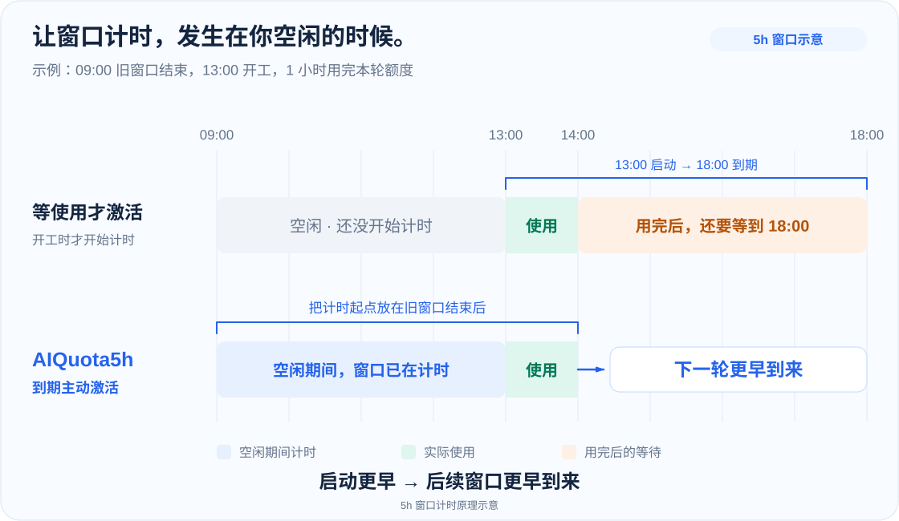
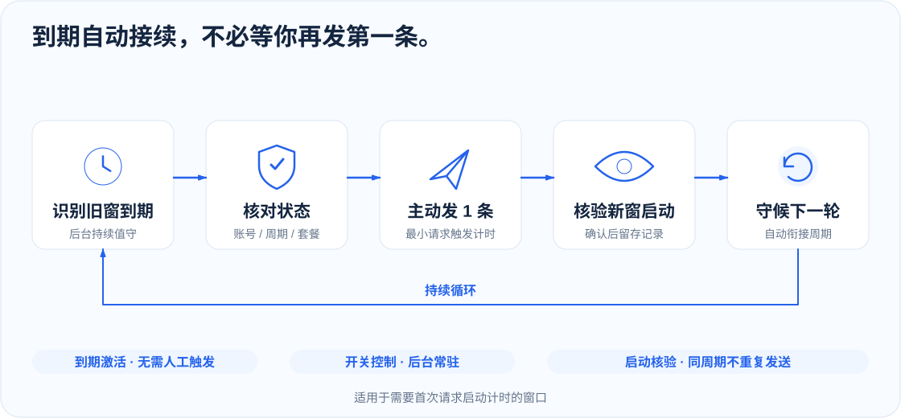
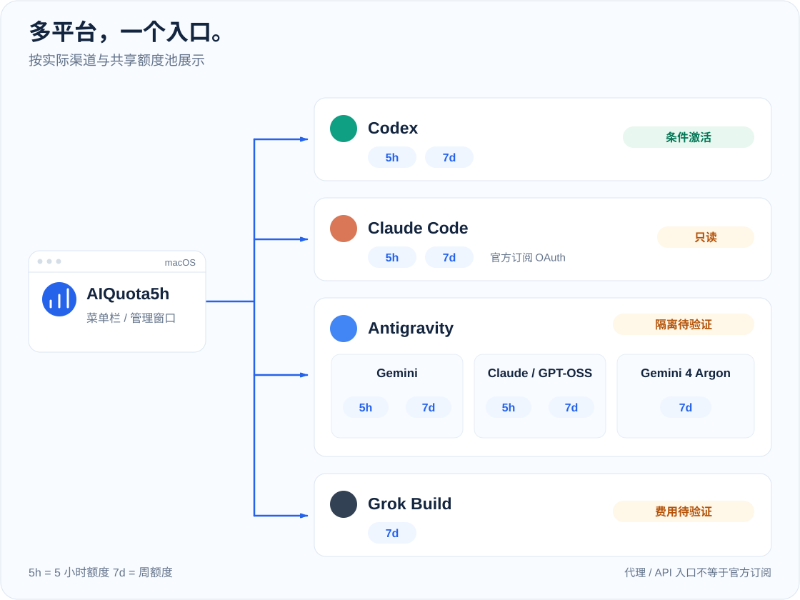

<p align="center">
  
</p>

<h1 align="center">AIQuota5h</h1>

<p align="center">
  <strong>旧额度窗口一结束就开启下一轮，不用等你开工。</strong><br>
  面向 5 小时 / 周额度窗口的 macOS 菜单栏应用和后台服务。
</p>

<p align="center">
  <a href="README.md">English</a> · 简体中文 · <a href="CHANGELOG.zh-CN.md">变更历史</a>
</p>

<p align="center">
  
</p>

## 为什么需要它

Claude Code、Codex 这类订阅制编程工具按滚动窗口计量用量，通常是 5 小时一轮，另有周额度上限。新窗口要等旧窗口结束后发出第一条请求才开始计时。旧窗口凌晨 3 点到期、你早上 9 点才开工，下一轮就是 9 点到 14 点，之后每一轮都跟着往后推。

AIQuota5h 负责盯住这些窗口。旧窗口结束约 65 秒后，它复核账号、剩余额度和费用条件，通过官方客户端发一条最小请求，再从官方额度数据确认新窗口确实已经开始计时。空闲的时间不再白白浪费。

## 功能

- **到期自动激活**：按额度池开关，旧窗口结束后等待 65 秒再处理。
- **有证据才发送**：只有官方数据证明旧周期已经结束才激活；发送后再读取额度，确认新窗口已启动。
- **费用把关**：只在请求由订阅覆盖时发送，例如额外付费明确关闭。费用状态不明时只监控。
- **不重复发送**：每个窗口周期最多一个激活任务。超时、重启、旧快照、窗口编号变化都不会让同一请求重发。
- **原生管理界面**：额度概览、按额度池的激活开关、按渠道的读取开关，以及额度读取和激活任务的历史。
- **后台常驻**：由 LaunchAgent 运行，关闭窗口后继续工作；「完全退出」会停止后台，下次打开应用时恢复。
- **自动处理换账号**：换成另一个账号登录后，旧账号的任务和快照自动清除。
- **只在本机运行**：复用各官方客户端已有的登录，界面不填密钥，不监听网络端口，账号在界面上脱敏显示。



## 支持的渠道

| 渠道 | 额度来源 | 激活方式 |
| --- | --- | --- |
| **Claude Code**（Pro / Max） | 官方 OAuth 额度接口，使用独立的订阅登录 | 向 Sonnet 发一条短消息激活 5 小时窗口；周额度按官方固定时间重置，只作为额度约束 |
| **Codex**（ChatGPT 套餐） | `codex app-server` 限额接口 | 通过只读沙箱中的 `codex exec` 激活，仅在套餐没有付费 credits 时发送 |
| **Antigravity** | 本机 language server；应用关闭时改用 `agy` CLI | 按额度池（Gemini、Claude / GPT-OSS、Gemini 4 Argon）处理，插件、MCP 和钩子隔离核对通过才发送 |
| **Grok Build** | 官方订阅接口 | 周额度按官方固定日程重置，只显示，不发送消息 |



各渠道的接入细节和判定依据见 [docs/ADAPTERS.md](docs/ADAPTERS.md)。

## 环境要求

- macOS 15 及以上
- Node.js 24 及以上
- Xcode Command Line Tools（构建原生应用）
- 需要管理的官方客户端已登录：`claude`、`codex`、`agy`、`grok`

## 安装

```bash
git clone https://github.com/ming2363/AIQuota5h.git
cd AIQuota5h
npm ci
npm test
npm run install:macos
```

安装脚本会构建后台服务和原生应用，安装 LaunchAgent `com.zhangming.aiquota5h`，并把应用复制到 `~/Applications/AIQuota5h.app`。重复运行即原地升级，保留设置和历史。

## 使用

从 `~/Applications` 或菜单栏打开 **AIQuota5h**。

1. **设置 → 自动读取额度**：打开你订阅了的渠道。关闭的渠道不在概览中显示，会员到期的渠道在这里关掉即可。
2. **额度概览 → 到期自动激活**：按额度池开启或关闭自动激活。
3. **调用历史**：在额度读取和自动激活之间切换，查看后台做了什么、为什么。

菜单栏有「退出管理界面（后台继续运行）」和「完全退出（同时停止后台）」两项。再次打开应用会自动恢复后台。

### Claude Code 订阅登录

Claude Code 使用独立登录，不改动你日常的 `~/.claude/` 配置（代理、插件、设置）。运行一次，在浏览器里选择已购买 Pro / Max 的账号：

```bash
node dist/src/index.js claude-login
```

凭证保存在 `~/Library/Application Support/AIQuota5h/claude-subscription/`，仅当前用户可读写。换了 Claude 账号，或界面提示登录已失效时，重新运行这条命令。

## 命令行

```bash
node dist/src/index.js status                   # 进程、读取和发送状态
node dist/src/index.js doctor                   # 检查客户端路径、LaunchAgent 和状态库
node dist/src/index.js refresh                  # 请求后台立即读取额度
node dist/src/index.js control monitor grok off # 关闭某个渠道的自动读取
node dist/src/index.js control activate claude on claude-subscription  # 按额度池开关自动激活
node dist/src/index.js pause | resume           # 暂停或恢复全部自动处理（重启后仍有效）
node dist/src/index.js start | stop             # 启动或停止后台服务
node dist/src/index.js history 0 | reads 0      # 以 JSON 输出激活任务 / 额度读取记录
node dist/src/index.js install | uninstall [--purge-data]
```

`status` 和 `doctor` 不会发消息，也不会再启动一个 daemon。`uninstall` 默认保留状态和日志，加 `--purge-data` 才删除。

## 文件位置

| 路径 | 内容 |
| --- | --- |
| `~/Library/Application Support/AIQuota5h/` | 已安装的后台程序、SQLite 状态库、Claude 订阅登录 |
| `~/Library/Logs/AIQuota5h/` | 后台日志 |
| `~/Library/LaunchAgents/com.zhangming.aiquota5h.plist` | LaunchAgent |
| `config/config.example.json` | 配置示例（客户端路径、刷新间隔、等待时间） |

不要把令牌写进配置文件，也不要分享或提交 `claude-subscription` 目录。

## 限制

- 应用是本机构建的 ad-hoc 签名，没有公证安装包，也不能直接拷到别的机器使用。
- 读取额度用到的官方接口属于客户端实现细节，接口变化时会停止读取或发送并报错，不会猜测结果。
- 无法证明窗口边界或费用边界时不激活，只监控。

## 开发

```bash
npm run build          # 编译 TypeScript
npm test               # 编译并运行全部测试
npm run build:macos    # 构建 dist/AIQuota5h.app
```

| 目录 | 内容 |
| --- | --- |
| `src/` | 后台服务：渠道适配、激活决策、核验、SQLite 存储、命令行 |
| `macOS/` | SwiftUI 管理界面和菜单栏应用 |
| `scripts/` | 构建和安装脚本 |
| `test/` | Node 测试 |

管理界面通过带超时的本地命令读取结构化 JSON 与后台通信，不启动 HTTP 服务。

更详细的运行说明见 [docs/USAGE.md](docs/USAGE.md)，版本变更见 [CHANGELOG.zh-CN.md](CHANGELOG.zh-CN.md)。
