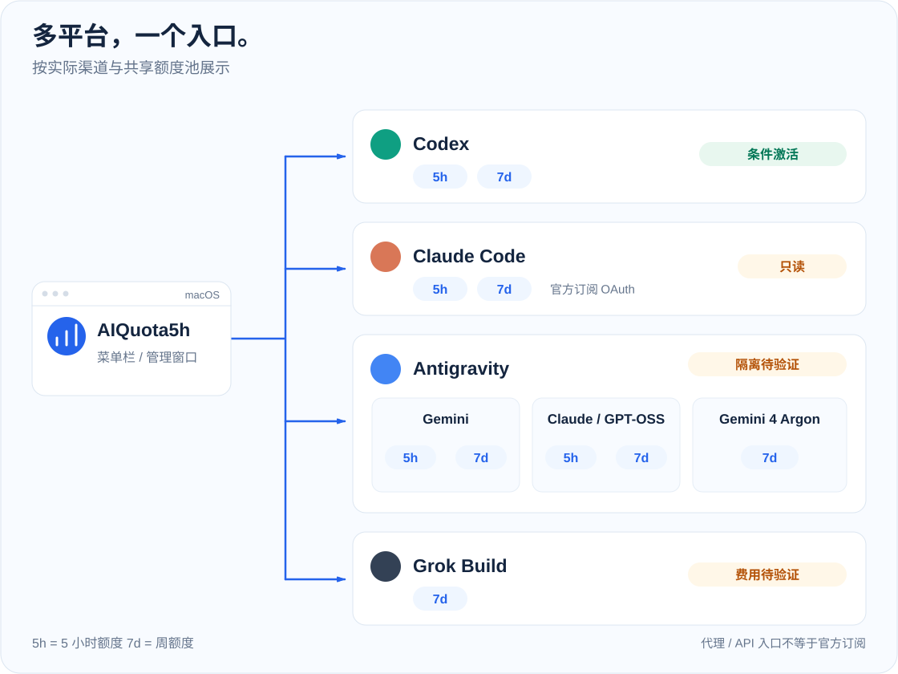

# 脱敏适配记录

调查时间：2026-10-16。账号、令牌和 CSRF 不写入本文。

## 渠道与窗口

## Codex

- CLI：`/opt/homebrew/bin/codex`，版本 `0.147.0`。登录方式 `codex login status` 为 ChatGPT。
- 稳定账号标识：`~/.codex/auth.json` 的 `tokens.account_id`（UUID，不是 token 哈希）。本次前缀 `be62c568`。
- 认证模式：`auth_mode=chatgpt`。`account/read` 返回 `planType=plus`，邮箱与 CLI 会话一致。
- 额度字段：`account/rateLimits/read` 的 `rateLimitsByLimitId.codex`。当前只有一个池 `codex`。
  - `primary`：300 分钟，本次 `usedPercent=24`，`resetsAt` 锚定在未来约 3.5 小时。
  - `secondary`：10080 分钟，本次 `usedPercent=51`，重置时间锚定。
  - `credits.balance=0`，`hasCredits=false`。存在两张未使用的重置券；本工具不调用消耗接口。
- 模型：`model/list` 本次返回 `gpt-5.6-sol`、`gpt-5.6-terra`、`gpt-5.6-luna`。发送候选按名称优先 Luna，并在执行前再次核对列表。用户配置里的 `gpt-6.1-sol` 未出现在这次列表中，因此不写死。
- 窗口判断：`usedPercent>0` 且 reset 锚定在未来，判定 active。`usedPercent=0` 加未来 reset 仍是 unknown。reset 已过去且没有新时钟，才把该服务端时间当作旧边界。
- 费用：只有 `credits` 对象明确给出 `hasCredits=false` 且 `balance=0`、认证为 chatgpt、且没有 API Key 时才标记 subscription_only。字段缺失、null 或无法解析时禁止发送。
- 发送参数：`-a never` 在 `exec` 之前；其后使用 `--ignore-user-config`、`--disable` 和只读沙箱。本机 `codex <完整参数> --help` 退出码为 0。不用危险绕过参数。
- App 关闭：读取走 CLI app-server，不需要图形程序保持打开。桌面端与 CLI 默认共用 `~/.codex/auth.json`。

## Claude Code（2026-10-24 新增，只读）

- 官方订阅登录态从 Claude 配置目录的 `.credentials.json` 或 macOS `Claude Code-credentials` 钥匙串项读取，令牌仅保留在内存。自定义 `CLAUDE_CONFIG_DIR` 使用该 CLI 的服务名哈希规则。
- 只请求官方 `https://api.anthropic.com/api/oauth/profile` 和 `/api/oauth/usage`；账号 UUID 来自同一令牌的官方账号响应，不把 token 哈希当账号。
- 这些路径来自本机官方 Claude Code 2.1.83 实现，属于客户端使用的接口，不能视为承诺稳定的公开 API。接口或凭证格式变化会导致读取失败，不降级为伪造数据。
- 展示 `five_hour`、`seven_day`、`seven_day_sonnet`、`seven_day_opus`、`seven_day_oauth_apps` 中实际存在的额度。`utilization` 按百分比处理，缺失、类型错误或越界值显示未知。
- 检测到代理 Base URL、API Key、认证令牌覆盖或 Bedrock / Vertex / Foundry 模式时，停止官方订阅读取，不改写任何用户配置、不替换登录态。凭证过期只报告重新登录，不自行刷新或保存 token。
- **没有接入发送器**：调用级隔离和额外费用尚未验证，前后端都拒绝开启 Claude 自动激活。此限制不会影响现有三个渠道。
- 官方关于五小时／周额度共享的说明：[Claude Help Center](https://support.claude.com/en/articles/11647753-how-do-usage-and-length-limits-work)。

## Antigravity

- App 2.23.1 已安装。官方 CLI 原先不在 PATH。已按官方清单校验 SHA-512 后，把 `agy` 1.4.0 放到 `~/.local/bin/agy`。没有运行 `agy install`，因此没有改 shell 配置。
- 稳定账号标识：Google 账号邮箱，不是 token。App language server 与 `agy` keyring 登录为同一 consumer 账号。
- 认证：`agy` 日志显示 `authenticated via keyring`，`authMethod=consumer`。`~/.gemini/settings.json` 里的 `gemini-api-key` 没有被这次 CLI 认证使用。
- 额度来源：本机 language server `RetrieveUserQuotaSummary`，不用百分比取整后的 `agy -p /usage`。
- 池映射（2026-10-16 实测）：
  - `gemini`：Gemini Flash/Pro，共享 `gemini-5h` 与 `gemini-weekly`。低消耗候选 `gemini-3.8-flash-low`。
  - `claude-gpt`：Claude 与 GPT-OSS，共享 `3p-5h` 与 `3p-weekly`。低消耗候选 `claude-sonnet-5-5-low`。
  - `gemini-argon`：Gemini 4 Argon 独立周池。候选 `gemini-4-argon-low`。
- 窗口证据：间隔约 26 秒重读时，已使用的周窗口和 Gemini 五小时窗口 reset 不变；`3p-5h` 剩余比例恰好为 1、没有 “you have used” 描述，reset 随墙钟滑动同样的秒数。这不是单独凭 100% 或未来 reset 推断，而是时钟滑动证明新五小时窗口尚未启动。旧边界服务端没有给出，所以不发送。
- 费用：`agy -p /credits` 显示剩余 AI credits 为 0。官方说明 credits 只在基线额度耗尽后、且用户打开 overage 时消耗。本地没有找到 overage 开关。调用级必须同时有 plugins、MCP、hooks 的精确开关。agy 1.4.0 三项都没有，发送未完成。
- 非图形读取：App language server 不在时，改用 `agy -p /usage` 和 `agy models`。2026-10-16 退出 Antigravity 后该路径读到三个池，并动态选择 `gemini-3.8-flash-low`、`claude-sonnet-5-5-low`、`gemini-4-argon-low`。CLI 把剩余显示成 100% 时不当作 idle 或 active。
- 发送隔离：`agy --help` 没有调用级禁用 plugins/MCP/hooks 的参数。发送器会在参数出现后使用它；当前返回 not_sent，不修改全局插件配置。

## Grok Build

- CLI：`/Users/zhangming/.local/bin/grok`，版本 1.0.46。`grok models` 显示已登录 grok.com，默认模型 `grok-4.7`。
- 稳定账号标识：`~/.grok/auth.json` 的 `user_id`，不是 token。订阅层级 SuperGrok。
- `grok agent stdio` 的 `x.ai/billing` 在本版本返回 Method not found。额度改读官方订阅接口 `GetGrokCreditsConfig`，令牌只在内存中使用。
- 本次解析：使用率字段为 1，周期开始 `2026-10-16T01:47:00Z`，结束 `2026-10-23T01:47:00Z`，正好 7 天且两次含义为锚定时间。
- 官方 FAQ 写明周额度按 Usage 页日程重置，消息不能启动窗口。用户在 2026-10-17 对话中说可以发一条、不在乎这一条额度；该授权不能代替套餐证明。费用为 unknown、blocked 或额度耗尽时不发送。当前未读到 Auto Top Up，标记为 billing_safety_unknown，因此只监控。
- 费用：CLI authenticate 的 `backend_billed=false`。没有读到 Auto Top Up 开关，发送安全标记为 `billing_safety_unknown`。由于无需激活，这不会触发消息。
- App 关闭：Grok Build 入口是 CLI。Grok Bot 不是本工具目标，不需要保持打开。
